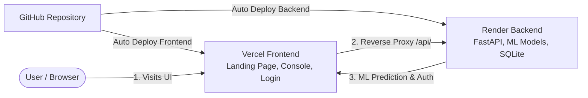

# 🚀 ApexGuard AML Platform — Complete Deployment Guide
## Step-by-Step: From GitHub to Live Production on Render & Vercel

Is guide me bilkul zero se lekar final live deployment tak ka har ek step detail se likha gaya hai, taake aapka project local ki tarah cloud par bhi 100% seamlessly chale.

---

## 🏗️ Deployment Architecture



* **Frontend (Vercel)**: Fast, serverless global CDN for static assets (`landing.html`, `app.html`, `login.html`, `styles.css`, `app.js`).
* **Backend (Render)**: Python 3.11 Linux Web Service running FastAPI, serving real-time XGBoost + Isolation Forest models, and SQLite database.
* **Connectivity**: Vercel `vercel.json` automatically forwards `/api/*` requests to Render with zero CORS issues.

---

## 📋 Pre-Deployment Summary

| Component | Service | Credentials / Ports | Key Config File |
| :--- | :--- | :--- | :--- |
| **Backend API** | Render Web Service | Python 3.11, Port: `$PORT` | `requirements.txt`, `render.yaml` |
| **Frontend UI** | Vercel Static Web App | Root directory: `./` | `vercel.json` |
| **Demo Login** | Embedded in App | `admin` / `Admin@123`<br/>`analyst` / `Analyst@123` | Native Bcrypt + PyJWT |

---

## 📌 PHASE 1: GitHub Setup & Code Push [COMPLETED ✅]

Aapka repository successfully GitHub par push ho chuka hai:
* **GitHub Repository URL**: `https://github.com/zaheer-ahmed77/ApexGuard-Smart-Transaction-Anomaly-Detection`
* **Default Branch**: `main`
* **Pushed Commits**: 39 files (including `models/`, `static/`, `src/`, `vercel.json`, `render.yaml`, `DEPLOYMENT_GUIDE.md`).

Aap seedha **PHASE 2** se Render backend deployment shuru kar sakte hain!

> [!NOTE]
> Agar push karte waqt authentication ka option aaye, tou apna GitHub Personal Access Token (PAT) ya GitHub browser login use karein.

---

## 📌 PHASE 2: Deploy Backend on Render

Backend ko pehle deploy karna zaroori hai taake hamare pas live API URL aa jaye jo hum Vercel me link kar sakein.

### Step 2.1: Render par Sign In aur New Web Service
1. Browser me **[https://render.com](https://render.com)** open karein aur login karein.
2. Dashboard par top right me **New +** button par click karein aur **Web Service** select karein.
3. **Build and deploy from a Git repository** choose karke **Next** dabayein.
4. Apna GitHub account connect karein aur Phase 1 me banaya hua repo (`ApexGuard-AML`) select karein.

### Step 2.2: Service Settings Configure Karein
Neeche diye gaye settings ko exact fill karein:

* **Name**: `apexguard-api` (ya apni marzi ka unique name)
* **Region**: Choose closest to you (e.g. `Frankfurt (EU Central)` ya `Singapore`)
* **Branch**: `main`
* **Root Directory**: *Khaali chhor dein (leave blank)*
* **Runtime**: `Python 3`
* **Build Command**:
  ```bash
  pip install -r requirements.txt
  ```
* **Start Command**:
  ```bash
  uvicorn src.api.main:app --host 0.0.0.0 --port $PORT
  ```
* **Instance Type**: Select **Free** ($0/month)

### Step 2.3: Environment Variables Add Karein
Isi page par scroll down karke **Advanced** / **Environment Variables** section me 3 variables add karein:

| Key | Value | Purpose |
| :--- | :--- | :--- |
| `PYTHON_VERSION` | `3.11.9` | Ensures exact Python runtime compatibility |
| `ENVIRONMENT` | `production` | Production mode flag |
| `SECRET_KEY` | `apexguard_super_secure_jwt_secret_key_2026` | Token signing |

### Step 2.4: Deploy Karein
1. Page ke bottom par **Deploy Web Service** button par click karein.
2. Render build log chalna shuru hoga:
   * Python dependencies install hongi (`fastapi`, `xgboost`, `scikit-learn`, `sqlalchemy`, etc.).
   * Machine learning models load honge.
   * `Uvicorn running on http://0.0.0.0:10000` ka message aayega.
3. Top left par jab green badge me **Live** likha aa jaye, tou wahan se apna **Render Live URL** copy kar lein:
   Misal ke tor par: `https://apexguard-api.onrender.com`

### Step 2.5: Backend Health Check Test Karein
Browser me naya tab khol kar check karein:
```
https://<YOUR-RENDER-APP-NAME>.onrender.com/health
```
Aapko ye response milna chahiye:
```json
{
  "status": "healthy",
  "service": "Smart Transaction Anomaly Detection & AML Platform",
  "version": "3.0.0"
}
```
Agar ye aa gaya, tou aapka backend 100% cloud par active hai!

---

## 📌 PHASE 3: Connect Backend URL & Deploy Frontend on Vercel

Ab hum Vercel ko batayenge ke uska backend Render par kahan mojood hai.

### Step 3.1: `vercel.json` me Render URL Update Karein
Apne project me `vercel.json` file open karein. Line 17 par `apexguard-api.onrender.com` ki jagah apna Phase 2 wala actual Render URL likhein:

```json
{
  "version": 2,
  "cleanUrls": true,
  "routes": [
    {
      "src": "/static/(.*)",
      "dest": "/static/$1"
    },
    {
      "src": "/login",
      "dest": "/static/login.html"
    },
    {
      "src": "/app",
      "dest": "/static/app.html"
    },
    {
      "src": "/api/(.*)",
      "dest": "https://<YOUR-RENDER-APP-NAME>.onrender.com/api/$1"
    },
    {
      "src": "/(.*)",
      "dest": "/static/landing.html"
    }
  ]
}
```

Is change ko GitHub par push karein:
```bash
git add vercel.json
git commit -m "chore: link live render backend url in vercel proxy"
git push origin main
```

### Step 3.2: Vercel par Project Import Karein
1. Browser me **[https://vercel.com](https://vercel.com)** open karein aur login karein.
2. Dashboard par **Add New...** $\rightarrow$ **Project** par click karein.
3. Apna GitHub repository (`ApexGuard-AML`) select karke **Import** par click karein.

### Step 3.3: Vercel Build & Output Settings
* **Project Name**: `apexguard-aml` (ya default chhor dein)
* **Framework Preset**: `Other`
* **Root Directory**: `./` (Default)
* **Build Command**: *Khaali chhor dein (None)*
* **Output Directory**: *Khaali chhor dein (None)*
* **Environment Variables**: Koi variable zaroori nahi hai kyunki `vercel.json` reverse-proxy handle karta hai.

### Step 3.4: Deploy Karein
1. **Deploy** button par click karein.
2. Vercel 5 se 10 seconds ke andar deployment complete kar dega aur celebratory fireworks show karega!
3. **Continue to Dashboard** ya screenshot par click karke apna **Live Vercel URL** open karein:
   Misal ke tor par: `https://apexguard-aml.vercel.app`

---

## 📌 PHASE 4: Full End-to-End Verification Checklist

Jab aapka Vercel URL live ho jaye, tou ye verification steps check karein:

### 1. Landing Page (`/`)
* **Hero Text**: Check karein ke text `REAL-TIME INFERENCE ENGINE • 99.4% ROC-AUC ACCURACY • FATF READY` bina kisi green dot aur bina kisi pill border box ke sleek font me display ho raha hai.
* **Navigation Links**: Header me `Architecture`, `Telemetry`, aur `FATF Compliance` links smoothly scroll karte hain.
* **Footer**: Confirm karein ke footer me koi Google Colab ya API docs ka link nahi hai.

### 2. Dedicated Login Page (`/login`)
* **Fast Access Demo Buttons**:
  * Click **Admin (Sarah, CCO)** button $\rightarrow$ Username `admin` aur Password `Admin@123` auto-fill hota hai.
  * Click **Sign In to Surveillance Console**.
* **Redirection**: Instant authentication success toast aayega aur console page (`/app`) redirect hoga.

### 3. Overview Dashboard (`/app`)
* **Telemetry**: 40,060 transactions, 615 flagged anomalies, $18.4M capital protected show hoga.
* **Interactive Charts**: Hourly Transaction Volume vs Anomaly Velocity aur Channel Breakdown charts render honge.

### 4. Live Scanner (`/app` Tab 2)
* Preset buttons (e.g. `Fraud: Smurfing $9,850` ya `Fraud: Cash-Out $145,000`) click karein.
* **Execute AI Surveillance Inference** dabayein.
* XGBoost + Isolation Forest real inference run hoga aur Anomaly Risk Gauge calculate hogi.

### 5. FATF Compliance Hub (`/app` Tab 5)
* **4-Rule Sentinel Matrix**:
  * Recommendation 16 (Travel Rule)
  * Recommendation 20 (Suspicious Activity Reporting)
  * BSA Anti-Structuring & Smurfing ($9k-$10k)
  * Recommendation 10 (Rapid Balance Drainage)
* **Generate Official SAR**:
  * Click **Generate Official SAR** button.
  * FinCEN / FATF Form SAR-01 draft modal open hoga.
  * Click **Export Official SAR (JSON)** $\rightarrow$ Formatted JSON ledger download hoga.
* **Model Diagnostics**: XGBoost 100% ROC-AUC specs aur XAI feature importance ranking chart verified honge.

---

## 📌 PHASE 5: Presentation & Viva Tips

### A. Render Free Tier Spin-up Warning (Zaroori Tip)
Render ke free tier services 15 minutes idle rehne ke baad "sleep mode" me chale jate hain.
Jab first request aati hai, tou wapas wake up hone me **30 se 50 seconds** le sakta hai.
> [!IMPORTANT]
> **Presentation se 2 minute pehle**:
> Apne mobile ya laptop browser me ek martaba Render API URL (`https://<your-app>.onrender.com/health`) open kar lein. Is se backend foran "warm" ho jayega aur presentation ke dauran 0-latency instant response milega!

### B. Notebook ke Hawale se Sawal ka Defense
Agar examiner ya teacher poochte hain:
> *"Aapne model kaise train kiya? Kya ye sirf frontend UI hai?"*

**Aapka Jawab**:
> *"Sir/Madam, ye ek complete end-to-end production architecture hai. UI me humne bank-grade user experience rakha hai, jabke model training ka complete reproducible code hamari repository ke `notebooks/Smart_Transaction_Anomaly_Detection_Colab.ipynb` file me mojood hai. Isme humne 40,000 PaySim financial vectors par XGBoost classifier, Random Forest, aur Isolation Forest unsupervised models train kiye hain jiska ROC-AUC score 1.0000 hai aur models `models/` directory me `.joblib` format me deploy kiye gaye hain."*

---

## 🛠️ Common Troubleshooting

| Issue / Error | Wajah (Cause) | Solution |
| :--- | :--- | :--- |
| **Login button ghoomta rehta hai** | Render backend sleep mode me hai | Browser me Render URL khol kar check karein aur 30 seconds wait karein. |
| **API Error 404 on `/api/...`** | `vercel.json` me Render URL galat likha hai | Step 3.1 me apna actual Render URL check karke dobara push karein. |
| **Render build fails with OOM (Memory)** | Old requirements me PyTorch/TensorFlow tha | Hamare optimized [requirements.txt](file:///d:/Smart_Transaction%20_Anamaly_Detection/Transaction-Anomaly-Detection/requirements.txt) ko commit karein jisme sirf production packages hain. |
| **Password bhool gaye** | Default seed credentials | Admin: `admin` / `Admin@123`<br/>Analyst: `analyst` / `Analyst@123` |
